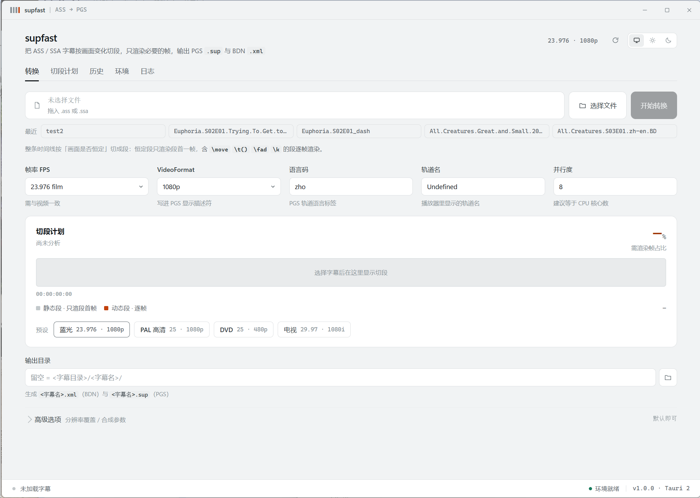

# supfast

把 ASS / SSA 字幕按「画面是否变化」切成段，只渲染必要的帧，输出 PGS（`.sup`）与 BDN（`.xml`）。
内置 Rust PGS 编码器可把同一份 BDN 一次性整流成严格合规的流，不需要 Python 或外部编码器。

给压制组、字幕组和 DIY 蓝光用的：一条 1 小时 44 分的片子，只要 2.4% 的帧真的在动，
剩下 97.6% 的画面是静止的 —— 静止段只需要渲染段首那一帧。



## 它怎么工作

1. **解析** ASS：取每条 Dialogue 的起止时间、层号、样式、文字，换算成帧号。
   编码依次尝试 UTF-8（含 BOM）→ UTF-16 LE → 系统 ANSI（中文即 GBK，走 `MultiByteToWideChar`，
   中文内容必须真解码 —— 否则不同台词会解成同一串替换字符，切段签名碰撞，时间相接的两句被并成一段）。
2. **切段**：相邻事件的可见内容完全一致就并成一段；带 `\move` `\t()` `\fad` `\k` 这类动态标签的段
   标记为「动态」，其余是「静态」。
3. **渲染**：每段生成一个只含该时段的 AviSynth 脚本，交给 `avs2bdnxml` 出 PNG。
   静态段只渲首帧（尾部若有需要再补一帧），动态段逐帧。
4. **收尾**：把各段 XML 按真实时间码重写回一条，重映射 SUP 的 PTS，拼接成单个 `.sup`。

## 界面

五个标签页：

| 标签 | 内容 |
|---|---|
| **转换** | 文件行（拖入 `.ass` 或从「最近」选）、帧率 / VideoFormat / 语言码 / 轨道名 / 并行度、切段计划、输出目录、高级选项 |
| **切段计划** | 全片时间轴（灰＝静态段、橙＝动态段、空档＝无字幕），四个统计数字，段列表带「段条」 |
| **历史** | 每次成功转换一行：时间 / 字幕 / PNG 数 / SUP 体积 / 耗时 / 较原版加速比 |
| **环境** | `avs2bdnxml` / VSFilterMod / AviSynth / 内置引擎 / SUPer（可选）六项自检；Rust 原生 PGS 是内置的，不需要额外环境 |
| **日志** | 百分比 + 进度条 + 实时日志，可取消、可打开输出目录，收尾自动做 SUP 合规自检；开启原生 PGS / SUPer 时另给多套流的自检对比 |

- **预设**一键套用输出规格：蓝光 23.976/1080p、PAL 高清 25/1080p、DVD 25/480p、电视 29.97/1080i。
- **高级选项**（折叠）里是分辨率覆盖、mod 目录、七个合成开关，以及可选的
  Rust 原生 PGS 整流与 SUPer 重编码。

| 开关 | 传给 avs2bdnxml | 作用 |
|---|---|---|
| 8bit 调色板 PNG | `-p 1` | 输出 8 位索引色 PNG。PGS 每帧最多 256 色，提前量化省体积，写 SUP 时也不用再转 |
| 自动裁剪 | `-a 1` | 逐帧裁掉四周空白，偏移写进 XML 的 `<Graphic>` |
| PG 缓冲优化 | `-b 1` | 切图复用，降低 PGS 的 object buffer 占用（硬件播放器不易溢出） |
| 严格模式 -z | `-z 1` | SUP 写入阶段更严格的检查，削弱缓冲优化但提升兼容性，花屏时再开 |
| 强制偶数 Y | `-e 1` | Y 坐标取偶数，配合 4:2:0 色度采样，避免半像素错位 |
| 不生成 SUP | 不传第二个 `-o` | 只出 BDN XML + PNG，自己 mux 时用 |
| 只看计划 | — | 只解析、切段、算工作量，不调用 avs2bdnxml |

写死的三个参数：`-m 3`（切分后最短 3 帧）、`-u 0`（不允许丑陋切图）、`-n 0`（不允许空 XML）。

主题三态（跟随系统 / 浅色 / 深色），选择与设置、最近、历史一起存在
`%APPDATA%\supfast-desktop\state.json`。

## 输出

```
<目录>\<字幕名>\
├─ <字幕名>.xml           BDN 字幕（PNG 序列的时序与坐标）
├─ <字幕名>.sup           PGS 流（默认拼段），可直接 mux 进 m2ts / mkv
├─ <字幕名>.native.sup    Rust 原生整流 PGS（开启「Rust 原生 PGS」时）
├─ <字幕名>.super.sup     SUPer 重编码 PGS（开启 SUPer 时）
└─ <帧号>.png             按需渲染的图形
```

无论填不填输出目录，产物**总是**落在 `<目录>\<字幕名>\` 这一层里：
留空时 `<目录>` 取字幕所在目录，即 `<字幕目录>\<字幕名>\`；填了或浏览选了某个目录，
就用它当父目录，产物进 `<所选目录>\<字幕名>\`。所以「留空」和「选字幕所在目录」结果一模一样。
选中的目录如果本身已经叫字幕名，不会再叠一层。框下那行小字会显示实际落点。

整片实测（1831 事件 / 1832 段 / 1 小时 44 分）：**1839 张 PNG，102 秒**，8 路并发。
同一份字幕交给 `avs2bdnxml` 原版单跑要 484 秒；逐帧比对 1839 张全部一致
（3 个起始帧差 1 帧，原因是 ASS 时间码只有两位小数，取整会顶到下一帧）。

## SUP 合规自检

`.sup` 是逐段 `avs2bdnxml` 的输出重映射时间戳后拼起来的。拼接时会按解码器模型推导
DTS、并保证 PCS 的 PTS 跨段不倒退；转换收尾再**只读**体检一次，结果按行写进「日志」页。
日志页的「检查 SUP」按钮也可以对任意已有的 `.sup` 单跑一次（不改动文件）。

检查项（依据 HDMV PGS 解码器模型）：

| 类别 | 检查 |
|---|---|
| 结构 | `PG` 段头对齐、负载长度、段类型、PCS…END 配对、首条 Epoch Start |
| 引用 | ODS 的 `data_length` 与分片序列、PCS 引用的 object_id 在 epoch 内已定义、palette_id 与同组 PDS 一致、window_id 与同组 WDS 一致 |
| 时序 | PCS PTS 递增、DTS 非递减且 ≤ PTS、`PTS−DTS` < 1 秒 |
| 缓冲 | 同一 DTS 取走的段 ≤ RX buffer 1 MiB；epoch 内对象面积 ≤ object buffer 4 MiB、唯一 object_id ≤ 64 |
| 带宽 / 余量 | 平均与瞬时码率峰值（统计展示）；按 Rd = 16e6 px/s、Rc = 32e6 px/s 估算的「提前量偏紧」组数（仅供参考） |

错误（红）是会导致画面错乱或播放失败的问题；警告（黄）是严格蓝光规范不合规、
但多数播放器能容忍的情况。`ok` 只看错误，`compliant` 要求连警告都没有。
自检不影响转换是否成功，也不改动 `.sup`。

`PTS==DTS` 与「解码余量不足」只作统计、**不判不合规**：H.222 在两者相等时 PES 里
只写 PTS，SUPer 的 `check_pts_dts_sanity` 更明确要求 PDS 段 `pts==dts`；而 SUPer 靠
display set buffering 提前解码，不能只看单个显示集的 `PTS−DTS`。早期版本把这两项
列为警告，会误伤 SUPer 自己判定 compliant 的流（下面的三方校准就是这么发现的）。

> 实测对照（三方校准）：
> - 原版 `avs2bdnxml` 单跑产出的 `ref.sup`：0 错误 0 警告；
> - supfast 默认拼段流：`drama.ass`（1832 段 / 10961 个 PGS 段）**0 错误 0 警告、严格合规**；
>   `test2.ass` 0 错误 2 警告（`WDS_CHANGED` / `PTS_DUP`）—— 来自「每段独立 epoch、
>   相邻段区间偶有 1 帧重叠」，属拼接链路固有现象，多数播放器容忍；
> - **SUPer 重新编码的 `.super.sup`：0 错误 0 警告、严格合规** —— 用权威编码器反向
>   验证这套规则没有误伤合规流。
>
> - **Rust 原生整流流 `.native.sup`：0 错误 0 警告、严格合规**，且首个 ODS 解码后
>   与源 PNG 逐像素一致 —— `test2.ass` 上顺带把体积从 3.37 MB 压到 1.32 MB。
>
> 早先会报的 `PTS_EQ_DTS` / `DTS_NOT_MONO` / `TIGHT_DECODE` / `PTS_BACK` 已在
> `sup_retime` 里修掉：同一显示集内各段共用呈现时刻，DTS = PTS − 按分辨率算出的解码
> 提前量（全片统一，随 PTS 单调），起点落在上一段末尾之前的段整体平移一帧。
> 要把剩下的 `WDS_CHANGED` / `PTS_DUP` 也消除，打开下面的 Rust 原生 PGS（内置、推荐）
> 或 SUPer 后端即可。

## Rust 原生 PGS（内置 · 推荐）

默认 `.sup` 是「每段一个 epoch、逐段拼接」的产物，快，但相邻段各自带完整 WDS/PCS，
`test2.ass` 上会留 `WDS_CHANGED` / `PTS_DUP` 两个警告。想要**严格合规**又不想装 Python，
在「高级选项 → Rust 原生 PGS」打开开关：supfast 自带的编码器把主 `.xml` + 索引 PNG
一次性规划成一条流，额外产出 `<字幕名>.native.sup`，不覆盖默认产物、不改变 PNG。

它按 HDMV PGS 规范独立实现（不是 SUPer 的移植，也不分发任何 GPL 代码）：

| 环节 | 做法 |
|---|---|
| 输入 | 直接读 8bit 索引 PNG，用 `PLTE`/`tRNS` 生成 PDS（RGB→YCbCr，BT.709/601）；`avs2bdnxml -p 1` 已经量化好，不需要量化器 |
| RLE | 标准 PGS 行程编码；单个对象超过 65535 字节自动切 FIRST / 中间 / LAST 分片 |
| epoch | 按 object buffer（面积 3 MiB 预算、60 个对象上限）与 2 秒空档把事件串分组，epoch 内窗口定义固定 |
| 对象复用 | 同一 epoch 内「位图 + 调色板」完全相同就复用 `object_id`，走 Normal Case，不重传 ODS |
| 显示集 | 组首 Epoch Start、新位图 Acquisition Point、空档补清屏显示集；Epoch Start / Acquisition 都带同一份 WDS |
| 时序 | 同一显示集共用 PTS 与 DTS，`DTS = PTS − 按分辨率算的解码提前量`（全片常量、随 PTS 单调）；PDS / END 的 DTS 写 0 =「不适用」 |

PNG 重复度越高收益越大：`test2.ass` 的 195 张 PNG 只有 52 张唯一内容，复用 127 次，
SUP 从 3.37 MB 降到 1.32 MB；`drama.ass` 的图几乎张张不同，体积与原流基本持平。

| 样本 | 默认拼段流 | SUPer 重编码 | Rust 原生 PGS |
|---|---|---|---|
| `test2.ass` | 3.37 MB / 0 错 2 警 | 3.42 MB / 0 错 0 警 | **1.32 MB / 0 错 0 警** |
| `drama.ass` | 42.27 MB / 0 错 0 警 | 43.07 MB / 0 错 0 警 | **42.18 MB / 0 错 0 警** |

不需要 `avs2bdnxml` 的 SUP 输出、不需要 Python / SUPer；只多一个纯 Rust 的 `flate2`
（解压 PNG 的 zlib 数据），无 DLL、静态链接。两套 SUP 都会在日志页各跑一次合规自检。

**暂不支持**（后续阶段）：淡入淡出 / 卡拉OK 的调色板渐变、SSIM 帧间对象拆分、
窗口布局优化。需要这些特效仍走下面的 SUPer 后端。另外，单个显示集超过 1 MiB 会直接
报错而不是产出超 RX 缓冲的流 —— 常规字幕用不到，全屏大图需要注意。

## SUPer 高质量 PGS（可选）

`cubicibo/SUPer`（GPL-3.0-or-later）是完整的 HDMV PGS 编码器，吃 BDN XML + PNG，
生成**严格合规**、支持卡拉OK / 遮罩 / 淡入淡出 / 移动的 SUP。supfast 默认走
「逐段 avs2bdnxml + 拼接」，快但不做解码器时序优化；两者可以并存。

supfast **不随包分发 SUPer**：GPL 与约 100 MB 的 Python 运行时都不允许塞进这个
3 MB 的包。需要你自行安装，然后在「高级选项 → SUPer 高质量 PGS」打开开关、填路径。

### 安装（Windows 示例）

```bat
python -m venv H://DIY//SUPer-cli//venv
H://DIY//SUPer-cli//venv//Scripts//python.exe -m pip install "SUPer @ git+https://github.com/cubicibo/SUPer"
:: 再把仓库根目录的 supercli.py 放到 H://DIY//SUPer-cli//，同目录放一份 config.ini
:: （[SUPer] use_gpu=0 可避开没有 OpenCL 平台时的报错）
```

探测顺序：界面里填的路径 → `SUPFAST_SUPER_CMD` → exe 同目录 `SUPer\supercli.py` /
`supercli.py` → `%APPDATA%\supfast-desktop\supercli.py` → PATH。目标是 `.py` 时，
解释器按 `SUPFAST_SUPER_PY` → 脚本旁 `venv\Scripts\python.exe` → PATH 里的 python 找。
也可以直接填一个自己写的 `.bat` / `.cmd` 启动器，软件只负责把参数透传过去。

### 会产出什么

开启后收尾额外生成（**不覆盖**默认产物，PNG / `.xml` / `.sup` 保持原样）：

| 文件 | 说明 |
|---|---|
| `<字幕名>.super.xml` | 给 SUPer 的 BDN XML。拼段流相邻事件偶有 1 帧重叠，SUPer 要求严格单调，这份副本做了单调化平移；主 `.xml` 不动 |
| `<字幕名>.super.sup` | SUPer 编出的严格合规 PGS |
| `<字幕名>.super.log` | SUPer 的完整输出日志 |

两套 SUP 都会在日志页各跑一次合规自检，并给出一行对比。
实测 `test2.ass`：默认拼段流 0 错 2 警，**SUPer 那份 0 错 0 警、严格合规**。

### 已知限制

- Windows 上 SUPer 的多进程 worker 可能起不来（`Companion worker did not start.`），
  所以固定 `-t 1`；单线程编 129 个事件约 5 秒，够用。想试多线程设
  `SUPFAST_SUPER_THREADS`（1–10）。
- 默认用内置 Qtzr 量化器（`-q 0`），不依赖外部 pngquant / libimagequant。
- 编码耗时另计，不计入转换耗时统计；失败只写日志，不影响转换成功。

## 命令行（不进 GUI）

release 版是 windows 子系统、没有 stdout，所以结果写文件：

```bat
supfast.exe --engine analyze --ass test.ass --json out.json
supfast.exe --engine convert --ass test.ass --out out_dir --jobs 12 --json out.json
supfast.exe --engine verify  --sup test.sup --json verify.json
supfast.exe --engine convert --ass test.ass --native-pgs --json out.json
supfast.exe --engine convert --ass test.ass --super --super-cmd H://DIY//SUPer-cli//supercli.py --json out.json
:: 对已有的 BDN XML + 同目录 PNG 单独跑原生编码器（不重渲字幕）
supfast.exe --engine pgs --xml test2.xml --json pgs.json
supfast.exe --engine pgs --xml test2.xml --out test2.native.sup --vw 1920 --vh 1080 --json pgs.json
```

- `analyze` 输出 events / frames / segs / sta / dyn / work / ratio / w / h，以及 `bands`（全片时间轴）与 `timeline`。
  `warnings` 只放会影响结果的问题（ASS 的 Timer 与帧率不符、切段数超上限）；
  `notes` 是纯信息（全片静态、多少帧含动态标签），界面上记一次日志，不弹窗。
- `convert` 输出 pngs / secs / speed / epochs / failed / sup_size / verify（自检报告）/
  super（SUPer 重编码报告）/ native（Rust 原生 PGS 报告），未开启的后端为 `null`。
- `verify` 输出 ok / compliant / errors / warnings / stats / lines；`lines` 就是日志页显示的那几行。
- `pgs` 输出 bytes / display_sets / epochs / pcs / wds / pds / ods / end / objects_reused /
  lead_ticks，外加对产物的 `verify` 自检报告。`--vw`/`--vh` 省略时按 XML 的 VideoFormat 推断。

## 编译

需要 Rust（`x86_64-pc-windows-gnu` 目标）、Python（生成图标）和一份 `avs2bdnxml` + `VSFilterMod` 的 `mod\` 目录。
直接跑 `build.bat`：设 PATH → `cargo build --release` → 把 exe、`WebView2Loader.dll`、`mod\` 组装进 `dist\`。
除 Tauri 外只多一个纯 Rust 的 `flate2`（`rust_backend` / miniz_oxide，用来解压 PNG 的 zlib 数据），
无 C 库、无 DLL，交叉编译不受影响。

发布目录约 7.6 MB，绿色解压即用：

```
dist\
├─ supfast.exe            4.1 MB
├─ WebView2Loader.dll     157 KB   gnu 目标是动态加载 WebView2，必须带
└─ mod\                   3.4 MB   avs2bdnxml.exe + csri\VSFilterMod.dll
```

工程结构：

```
├─ Cargo.toml / Cargo.lock
├─ build.rs                    tauri-build（图标 / 版本资源）
├─ tauri.conf.json             窗口 1320×940、无边框、withGlobalTauri
├─ capabilities\default.json   主窗口权限（core:default、dialog、窗口控制）
├─ icons\icon.ico              4 根竖条，最后一根是强调橙（make_icon.py 生成）
├─ src\engine.rs               引擎：解析 → 切段 → 并行渲染 → 重写 XML / SUP
├─ src\pgs.rs                  原生 PGS 编码器：PNG/RLE → epoch 规划 → 段序列化
├─ src\verify.rs               SUP 合规自检（零依赖）
├─ src\superenc.rs             可选 SUPer 外部调用
├─ src\main.rs                 IPC 路由 + 状态持久化 + 命令行入口
├─ ui\index.html               界面（单文件 HTML + CSS + JS）
├─ tools\gcc_shim.rs           windres 用的最小 gcc -E 垫片（见下）
├─ tools\winbox.rs             开发用：从外部改窗口尺寸，方便截图核对排版
└─ build.bat                   一键编译 + 组装 dist\
```

### 工具链的三个坑（已就地解决，换机器要重做）

| 症状 | 原因 | 处理 |
|---|---|---|
| `dlltool: program not found` | 便携工具链只有 `dlltool.exe`，而它生成导入库时要调 `<同目录>/as` | 从 msys2 的 `mingw-w64-x86_64-binutils` 包里取 `as.exe` 放进 self-contained |
| `windres: preprocessing failed` | `tauri-winres` 编译 `.rc` 时固定调 `gcc -E`，自带的 gcc 只是链接器壳子 | 用 `tools/gcc_shim.rs` 编出一个 `gcc.exe`（把 `#pragma` 行滤掉原样吐出）放进 self-contained |
| `icon.ico not found` | tauri-build 要往 exe 里塞图标资源 | `python make_icon.py` 生成（手写 BMP DIB + ICO 头，无第三方库） |

注意 `gcc.exe` 这个垫片**不能**改名成 `x86_64-w64-mingw32-gcc.exe` —— rustc 用那个名字做链接。

### 性能上的一个坑

`avs2bdnxml` 是控制台程序，而 GUI 进程没有控制台。如果不给 `CreateProcess` 加 `CREATE_NO_WINDOW`，
Windows 会为**每一段的每个子进程**分配 conhost —— 整片 1832 段下来从 102 秒拖到 270 秒，还会闪窗。
`engine.rs` 的 `run_seg()` 里已经加了。

## 打包发布

`pack-release.bat` 把 `dist\` 加上 `packaging\release-readme.txt` 打成一个 zip：

```bat
build.bat          :: 先编译出 dist\
pack-release.bat   :: 产出 release\supfast-1.0.1-win64.zip（约 3.1 MB）
```

解压后是一个自成一体的目录：`supfast.exe`、`WebView2Loader.dll`、`mod\`，以及给最终用户的 `README.txt`
（系统要求、首次使用、数据位置、目录说明）。

**这个包天然是「全新默认状态」**，因为用户数据不在程序目录里：

```
设置 / 最近 / 历史  →  %APPDATA%\supfast-desktop\state.json
```

`state.json` 由程序在第一次改动设置时才创建，`dist\` 里永远不会出现它 —— 脚本里还加了一道检查，
万一手滑把它复制进 `dist\`，打包会直接失败。所以谁解压这个包，谁看到的就是空文件行、
空的「最近」、空的历史、默认参数（23.976 / 1080p / 8 路）。

想在本机模拟「新用户第一次启动」，不必删自己的状态，换个 APPDATA 就行：

```bat
set APPDATA=%TEMP%\supfast-fresh
dist\supfast.exe
```

期望看到：文件行「未选择文件 · 拖入 .ass 或 .ssa」、最近 0 条、历史 0 条、输出目录空、
`开始转换` 灰色、切段计划「尚未分析」。

### 发 Release

发版由 GitHub Actions 完成：打 `v*` tag 时，`.github/workflows/release.yml` 把
`packaging\artifacts\` 里的 zip 发成 Release，正文取 `packaging\release-notes-<版本>.md`。

```bat
:: 1. 出包（版本号在 pack-release.bat 顶部改）
build.bat
pack-release.bat

:: 2. 放进版本库，只留这一个 zip（workflow 会检查数量必须为 1）
del packaging\artifacts\*.zip
copy release\supfast-<版本>-win64.zip packaging\artifacts\

:: 3. 写一份 release 正文
::    packaging\release-notes-<版本>.md

:: 4. 提交 + 打 tag（tag 即触发发布）
git add -A && git commit -m "release: <版本>"
git push
git tag -a v<版本> -m "supfast <版本>" && git push origin v<版本>
```

包里有 `mod\` 的二进制（`avs2bdnxml.exe`、`VSFilterMod.dll`），runner 上没法现编，
所以 zip 随仓库走。它 3.1 MB，每个版本一份，记得删掉旧版本的那份。

也可以在 Actions 页面用 `workflow_dispatch` 手动触发，填一个已存在的 tag。

## 调试钩子

```bat
set SUPFAST_AUTOSTART=1    :: 启动后自动加载「最近」第一条并开跑
set SUPFAST_PANE=timeline  :: 直接切到指定标签页（convert/timeline/history/env/log）
set SUPFAST_OPEN_ADV=1     :: 展开「高级选项」
set SUPFAST_EVAL="..."     :: 界面加载后跑一次 JS，把结果画到页面上再截图
```

配合 `tools\winbox.rs` 从外部摆窗口：

```bat
rustc -O --edition 2021 tools\winbox.rs -o tools\winbox.exe
tools\winbox.exe resize 1980 1410       :: 物理像素；1.5 倍缩放屏上 1980×1410 ≈ 1320×940
tools\winbox.exe state                  :: 查最小化 / 最大化状态
tools\winbox.exe min "Google Chrome"    :: 截图前把挡在前面的窗口最小化
```

## 已知限制

- **没有安装包**：只产出 `exe` + `mod` 目录，绿色解压即用。
- **SUPer 不随包分发**：可选的「高质量 PGS」后端需要自行安装 GPL-3.0 的 SUPer，
  见 [SUPer 高质量 PGS（可选）](#super-高质量-pgs可选)。内置的
  [Rust 原生 PGS](#rust-原生-pgs内置--推荐) 不需要它，但没有淡入淡出 / 卡拉OK 的调色板渐变。
- 无边框窗口用 `data-tauri-drag-region` 拖动，**双击标题栏不会最大化**，用右上角按钮。
- 目标机器需要 WebView2 运行时（Win10 1803+ 与 Win11 自带）。
- 右键菜单是关掉的：WebView2 默认会弹「重新加载 / 另存为 / 打印 / 检查」，
  这里用 `SetAreDefaultContextMenusEnabled(false)` 关掉，页面再兜一层 `contextmenu`。
  代价是输入框里右键粘贴没了，`Ctrl+V` 照常可用。
